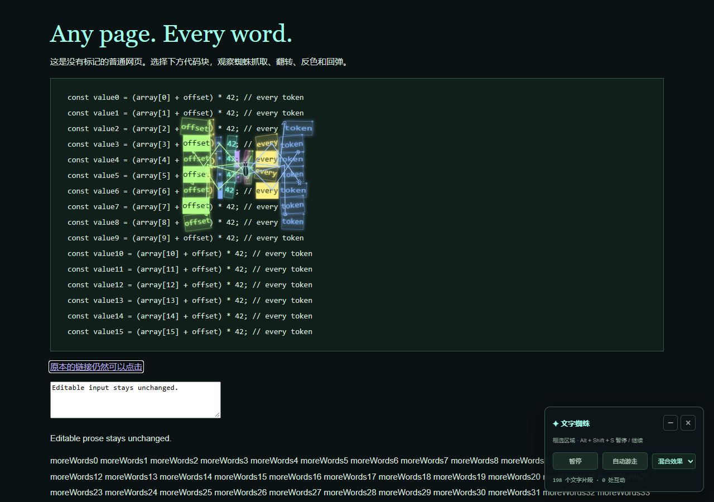
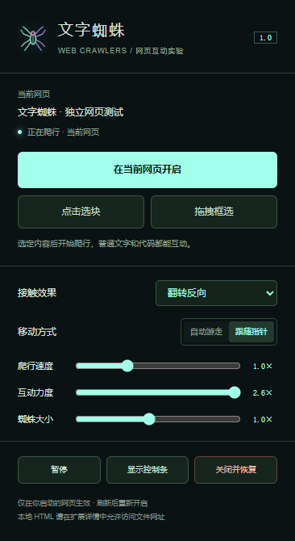

# 南灼 · 文字蜘蛛

让蜘蛛走进你选定的网页。脚尖抓住真实文字，腿部扫过也会触发抓取、翻转、反色、扭转、拉伸与回弹。

**作者：南灼** · v1.0.0 · 电脑端 Chrome / Microsoft Edge

[下载安装包](https://github.com/seafai/git-demo/raw/refs/heads/master/nanzhuo-web-crawler/downloads/nanzhuo-web-crawler-v1.0.0.zip) · [完整使用说明](USAGE.md) · [下载带水印的说明书](https://github.com/seafai/git-demo/raw/refs/heads/master/nanzhuo-web-crawler/downloads/nanzhuo-manual.zip)

说明书下载后解压，双击里面的 HTML 文件，即可离线阅读。

## 安装

1. 点击上方“下载安装包”，完整解压 ZIP，保留 `web-crawler-extension` 文件夹。
2. Chrome 地址栏输入 `chrome://extensions`；Edge 输入 `edge://extensions`，开启“开发者模式”。
3. 点击“加载已解压的扩展程序”，选择直接包含 `manifest.json` 的 **web-crawler-extension** 文件夹。
4. 在浏览器的“扩展”菜单中将“文字蜘蛛”固定到工具栏。

解压后的文件夹需要保留。本版提供可直接加载的扩展文件，尚未发布到扩展商店。

## 开启与控制

打开目标网页，点击工具栏上的蜘蛛图标，选择 **当前网页**、**点击选块** 或 **拖拽框选**。

可切换接触效果、自动游走 / 跟随指针，调整速度、互动力度和大小。网页右下角的控制条可以暂停、切换效果，以及关闭并恢复网页。

| 操作 | 快捷键 |
| --- | --- |
| 暂停 / 继续 | Alt + Shift + S |
| 关闭并恢复 | Alt + Shift + X |
| 取消选择 | Esc |

## 范围与隐私

适用于普通网页主页面的文字和代码。浏览器设置页、扩展商店、内置 PDF、图片 / Canvas 内的字、跨域 iframe、Shadow DOM 和可编辑区域不参与文字互动。使用本地 HTML 时，需要在扩展“详细信息”中开启“允许访问文件网址”。

点击扩展后才访问你选定的网页。动画在本机运行，不上传网页文字或截图。每个标签页分别运行；刷新或跳转后需要手动再次开启。

## 仓库内容

- `web-crawler-extension/`：可直接加载的浏览器扩展源码。
- `downloads/`：解压即用的安装包。
- `USAGE.md`：完整中文使用说明。
- `docs/`：下载与说明页面，署名为南灼，带非常浅的“南灼”水印；页面下载入口跳转至当前 GitHub 仓库。

网站和 HTML 说明书中的水印不影响点击或阅读。
